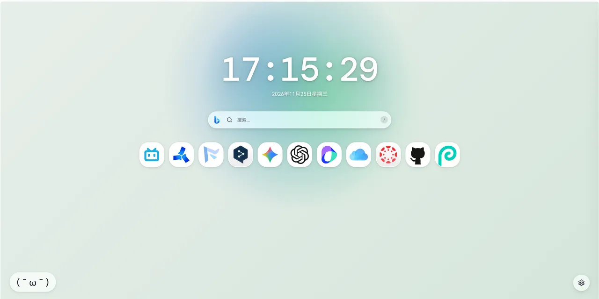
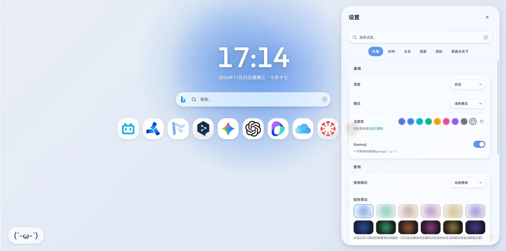
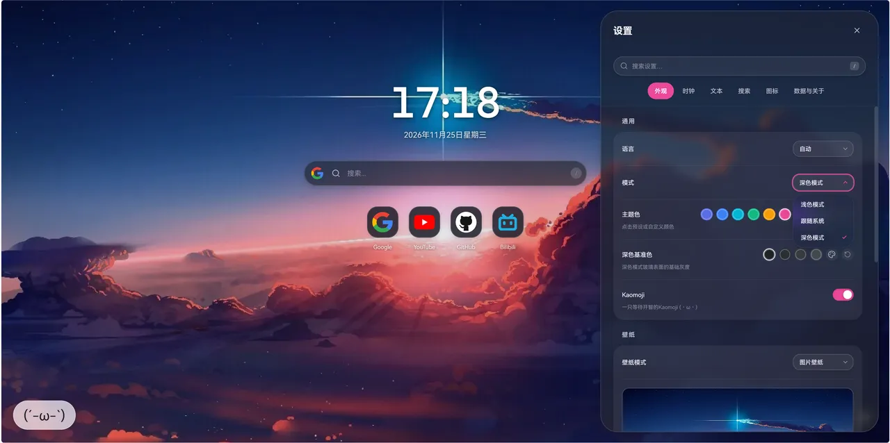
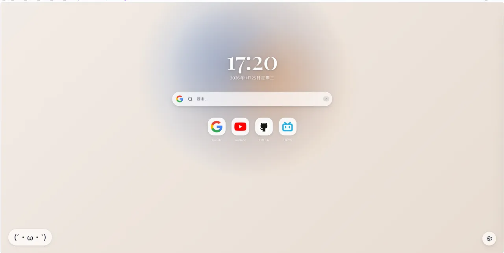

<p align="center">
  
</p>

<h1 align="center">Frostart</h1>

<p align="center">
  <a href="https://github.com/Gledery/frostart/releases/latest"></a>
  <a href="./LICENSE"></a>
  <a href="https://developer.chrome.com/docs/extensions/develop/concepts/manifest-files"></a>
  <a href="https://frostart.pages.dev/newtab"></a>
</p>

## 效果预览



<table>
  <tr>
    <td></td>
    <td></td>
    <td></td>
  </tr>
</table>

## 这是什么

**Frostart** 是鸢做的一款可高度自定义的本地毛玻璃浏览器首页插件~

壁纸的可选模式包括光斑、纯色、本地图片、网络图片或者必应每日壁纸，其中默认的光斑模式有很多很用心打磨的细节，比如联动主题色，深浅切换适配等，可以探索一下

时钟可以显示秒、星期和农历，目前一共支持了十款字体

搜索框内置了 18 个常用的搜索引擎，也支持自定义引擎（URL 里用 `%s` 占位）

快捷方式的图标可以从本地上传图片和 SVG，也能自动抓 favicon，还有独立的编辑器

所有设置收在右侧抽屉里，可以从右下角的图标打开。一共分外观、时钟、文本、搜索、图标、数据与关于六个分区，支持搜索定位且所有改动都实时生效

> [!IMPORTANT]
> 此插件所有数据都只留在你自己的浏览器里，配置可以随时导入导出。没有任何弹窗，收费，广告或者内购，以后也不会有（我的人品应该还是比很多公司要强的吧

（右下角还有一只等待开智的 Kaomoji，但是 Kaomoji 这个名字太没意思了，想起个新的）

<p align="center">
  <b>(・ω・)</b>
</p>

设计语言继承自我自己维护的 [PhasWer 小站](https://github.com/Gledery/PhasWer-Site)。这是我第一次写这种工具性的项目，所以肯定有各种问题，很期待大家的反馈！

## 在线体验

打开 [frostart.pages.dev/newtab](https://frostart.pages.dev/newtab) 即可预览最新稳定版，无需安装，功能与扩展版一致

> [!NOTE]
> 线上版本只跟踪正式 Release；main 分支上的开发版不会上线。网页版数据与关于里的"下载安装包"拉取的是 GitHub 最新 Release 的资产

## 安装与更新

### 从源码加载（既然你都已经在这里了。。。）

1. Clone 或下载本仓库
2. 打开 `chrome://extensions/`
3. 右上角点击开启开发者模式
4. 点"加载已解压的扩展程序"，选仓库根目录
5. 开个新标签页就能看到了

> Edge / Brave / Vivaldi / Arc 等 Chromium 系浏览器应该也能用，没全部测过

### 下载正式安装包

在 [Releases 页面](https://github.com/Gledery/frostart/releases/latest) 下载最新版资产（优先手动上传的安装 ZIP，源码 ZIP 兜底），解压后按上面方式一的步骤 2–5 加载；也可以在[在线网页版](https://frostart.pages.dev/newtab)的数据与关于里点"下载安装包"直接获取

> [!TIP]
> 如果下载的是源码 ZIP，加载时要选包含 manifest.json 的内层文件夹

### 更新

由于插件以已解压的扩展程序方式加载，Chrome 不会自动更新，需要手动替换文件：

1. 打开新标签页时会自动检查 GitHub Releases（每 6 小时一次），有新版本时版本号旁会出现徽章，设置图标上也会有小红点
2. 也可以在设置的数据与关于里点"检查更新"手动检查
3. 点徽章跳到 Release 页面，下载新版本的安装包
4. 解压并用新文件替换旧的扩展目录（或放一个新目录）

> [!NOTE]
> 配置保存在 `chrome.storage.local`，更新代码不会丢失设置

## 项目结构

```
Frostart/
├── manifest.json          # MV3 清单
├── newtab.html            # 新标签页（扩展主页面）
├── changelog.html         # 更新日志
├── converter.html         # iTab ⇄ Frostart 转换工具（独立网页，不属于扩展页面）
├── index.html             # 落地页
├── css/
│   ├── tokens.css         # 设计令牌（@property / 主题变量）
│   ├── base.css           # 重置 / 壁纸系统 / 玻璃效果
│   ├── settings.css       # 设置抽屉框架与通用控件
│   ├── panels.css         # 设置面板内容区块
│   ├── components.css     # 主屏组件与全局兜底（最后加载）
│   └── pages.css          # 页面专属样式
├── js/
│   ├── i18n.js            # 中英双语字典与语言切换
│   ├── select.js          # 自定义 Select 下拉组件
│   ├── settings.js        # 配置管理（防抖保存 / 迁移 / 备份）
│   ├── wp-cache.js        # 首屏壁纸缓存
│   ├── services.js        # 公共服务层
│   ├── page-theme.js      # 子页面主题同步
│   ├── changelog.js       # 版本数据与日志渲染
│   ├── core.js            # 应用骨架
│   ├── sliders.js         # 滑块系统
│   ├── panels.js          # 设置面板
│   ├── widgets.js         # 快捷键 / 右键菜单 / 拖拽 / 图标编辑器
│   ├── packager.js        # 网页版下载正式安装包入口
│   ├── kaomoji.js         # 角落颜文字
│   └── utils/             # 数学 / 字符串 / 色彩 / 字体 / 版本 / 图标工具函数
├── icons/                 # 扩展图标、内置引擎图标与 UI 图标精灵表（ui-sprite.svg）
├── docs/                  # 截图与文档用图片
├── PRIVACY.md             # 权限与隐私说明
└── LICENSE                # GPL-3.0
```

## 技术栈

使用的包括原生 JS，CSS Custom Properties + `@property` + `backdrop-filter`，Canvas 压图和 FLIP 动画。

之所以不上框架，一是插件就这么大没必要，二是想保持代码可直接阅读，这样想抄哪段直接拿走就行（只要遵守 GPL-3.0协议都欢迎）。

### 浏览器兼容性

基于 Manifest V3，只支持 Chromium 内核浏览器，最低版本要求 Chrome **111+**，主要卡在 `color-mix()` 这类 CSS 特性的支持门槛：

| 浏览器 | 状态 | 说明 |
| --- | --- | --- |
| Chrome | ✅ 主要测试环境 | 111+ |
| Edge | ✅ 已测 | Chromium 内核，111+ |
| Brave | 🟢 应该可用 | 未深度测试 |
| Vivaldi | 🟢 应该可用 | 未深度测试 |
| Arc | 🟢 应该可用 | 未深度测试 |
| Firefox | 🟡 未适配 | 已支持 MV3，但未做兼容与测试 |
| Safari | 🟡 未适配 | 需另写 Safari Web Extension |

> 权限相关的说明写在 [PRIVACY.md](./PRIVACY.md) 里

---

## 隐私

**此插件不收集任何数据**，详见 [PRIVACY.md](./PRIVACY.md)

## 贡献与联系

非常欢迎反馈 bug、提建议或直接贡献代码，约定请看 [CONTRIBUTING.md](./CONTRIBUTING.md)

也可以直接 [B 站私信](https://space.bilibili.com/3461577804089941) 找我

## 协议

[GPL-3.0](./LICENSE) © 灰鸢 Gledery

界面图标取自 [Lucide Icons](https://lucide.dev)（ISC 许可），vendored 在 [icons/ui-sprite.svg](./icons/ui-sprite.svg)

---

<p align="center">
  © 灰鸢 Gledery 闲的没事用肝创建 (。・ω・。)<br>
  你滑到底了哇，去喝杯水吧~
</p>
